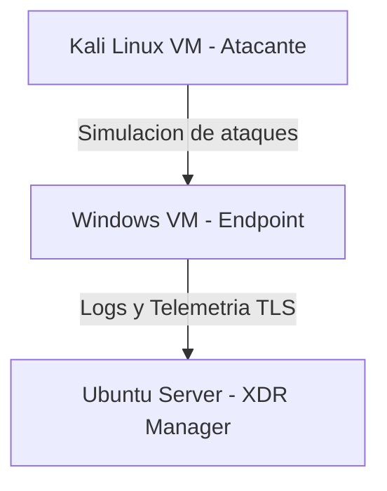
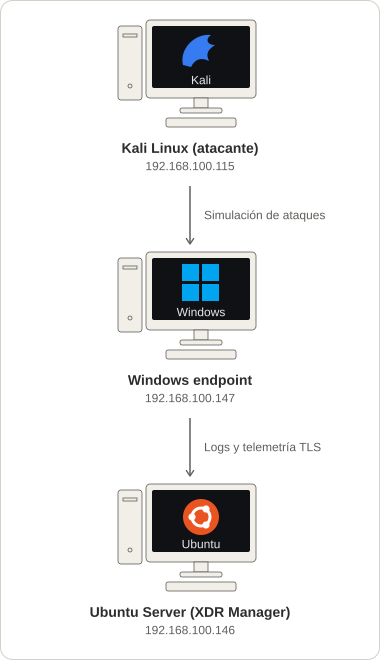

# 01. Arquitectura de Red y Topología

## 🎯 Objetivo de la Sección
Definir la topología del entorno de pruebas virtualizado, identificando los componentes que participan en la simulación de ataques, la recolección de telemetría, la visualización centralizada de alertas de seguridad mediante la solución XDR y la conexión de red junto con la dirección ip de cada máquina.

---

## 🏗️ Topología del Laboratorio


<div align="center">

*Figura 1: Topología de red del laboratorio. El agente XDR instalado en la máquina Windows monitorea y envía los registros de eventos mediante una conexión cifrada TLS hacia el servidor XDR en la máquina Ubuntu. La máquina Kali Linux actúa como el agente hostil externo encargado de realizar las simulaciones de ataque para activar las alertas de seguridad.*

</div>

## 🌐 Configuración de red
La figura 2 ilustra las direcciones IP asignadas a cada máquina. en este caso se utilizó una conexión de red de tipo puente.

graph TD
    Kali["🏴‍☠️ Kali Linux (Atacante) <br/> <code>192.168.100.115</code>"] -->|Simulación de ataques| Win["💻 Windows Endpoint <br/> <code>192.168.100.147</code>"]
    Win -->|Logs y Telemetría TLS| Ubuntu["🐧 Ubuntu Server (XDR Manager) <br/> <code>192.168.100.146</code>"]
```

