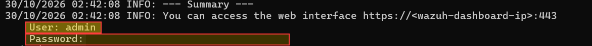

# 01. Instalación de herramienta XDR Wazuh
## Objetivo de la sección


Para la instalación de la herramienta xdr wazuh, primero se debe descargar e importar la clave GPG del repositorio oficial de wazuh que verifica la autenticidad, integridad del software y permite la confianza entre el sistema operativo y el repositorio externo de wazuh. 
```bash
curl -s https://packages.wazuh.com/key/GPG-KEY-WAZUH | sudo gpg --dearmor -o /usr/share/keyrings/wazuh-archive-keyring.gpg
```
Luego se puede descargar e instalar de manera automatizada la solución xdr wazuh mediante el siguiente comando.
```bash
curl -sO https://packages.wazuh.com/4.12/wazuh-install.sh && sudo bash ./wazuh-install.sh -a -i
```
Después de completarse la instalación, se proporcionarán las credenciales para ingresar al dashboard.


