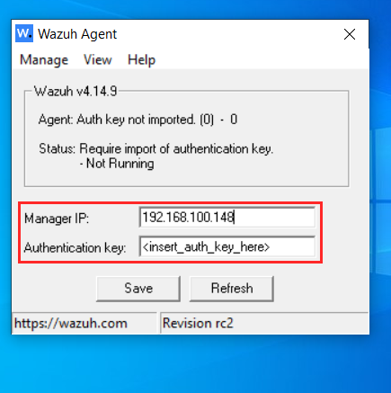
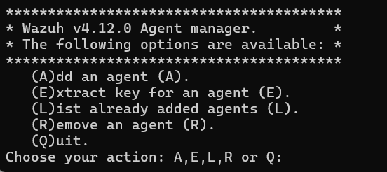
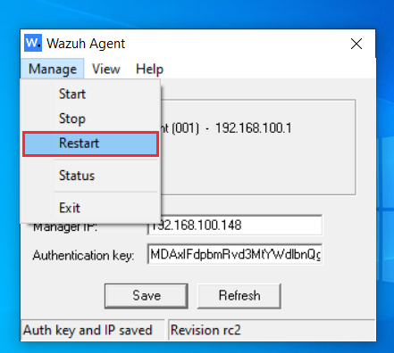

## 03 Configuración del agente en máquina windows para telemetría de logs
---
## Objetivo de la sección
Presentar los pasos para la configuración del agente Wazuh en la máquina windows.

---
## Instalación del agente en máquina windows
Para la instalación del agente, se debe ingresar al siguiente link para descargar el instalador en una máquina windows para después ejecutarlo.
<p align="center">
  <a href="https://documentation.wazuh.com/current/installation-guide/wazuh-agent/wazuh-agent-package-windows.html">Deploying Wazuh agents on Windows endpoints - Wazuh agent</a>
</p>
Luego de la instalación, aparecerá una ventana de configuración como la que se muestra en la figura 1, en donde se debe ingresar la ip de la máquina que ejecuta el XDR Wazuh (una máquina ubuntu en este caso) y una clave de autenticación.
<p align="center">
  
</p>
<p align="center">
  <em>Figura 1: Configuración del agente Wazuh en el endpoint Windows.</em>
</p>
---

## Obtención de la clave de autenticación
Para la obtención de la clave de autenticación, se debe añadir un nuevo agente en el administrador de XDR Wazuh (máquina ubuntu). Para ello, basta ejecutar el siguiente comando;
```bash
sudo /var/ossec/bin/manage_agents
```
Posterior a eso aparecerán las opciones que se muestran en la figura 2.
<p align="center">
  
</p>
<p align="center">
  <em>Figura 2: Menú de opciones de manage_agents en el servidor Wazuh.</em>
</p>
Se debe escoger la opción A para añadir un nuevo agente. Después de eso se solicitará el nombre para designar el agente y la dirección ip (dirección ip de la máquina windows en este caso). Luego de eso se debe solicitar una cleve para dicho agente, la cual se puede obtener con la opción E. Una vez seleccionada la opción, se debe ingresar el ID asignado al agente (este se asigna una vez finalizamos con la opción A) y se mostrará la clave de autenticación asignada. Una vez ingresada la clave en la máquina que ejecuta el agente (máquina windows), se debe guardar y reiniciar el agente como se muestra en la figura 3.

<p align="center">
  
</p>

<p align="center">
  <em>Figura 3: Reinicio del agente Wazuh desde el menú Manage para aplicar la configuración.</em>
</p>
